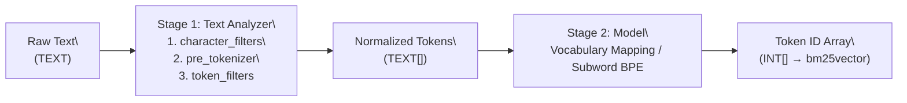

## Two-Stage Tokenization Pipeline

A `tokenizer` in `pg_tokenizer` consists of up to two stages that transform a raw `TEXT` string into an `INT[]` array of integer token IDs:



1. **Text Analyzer (`text_analyzer`)**: Splits raw text into a `TEXT[]` array of normalized string tokens by applying a sequential pipeline of:
   - **Character Filters (`character_filters`)**: Transform the raw string before splitting (e.g., `to_lowercase`, `unicode_normalization`).
   - **Pre-tokenizer (`pre_tokenizer`)**: Splits the string into initial substrings (`unicode_segmentation`, `regex`, or Chinese `jieba`).
   - **Token Filters (`token_filters`)**: Filter or transform individual tokens (`skip_non_alphanumeric`, `stemmer`, `stopwords`, `synonym`, `pg_dict`, `ngram`).
2. **Model (`model`)**: Maps the string tokens (or raw text, for standalone subword models like `llmlingua2`, `bert_base_uncased`, `gemma2b`, HuggingFace, or `lindera`) into integer token IDs (`INT[]`).

> [!NOTE]
> - **Pretrained subword models** (`llmlingua2`, `bert_base_uncased`, `gemma2b`), **HuggingFace models**, and **Lindera models** include their own built-in tokenization rules and do not require a separate `text_analyzer` stage.
> - **Dictionary/corpus models** (`wiki_tocken` and custom models created via `create_custom_model`) require a `text_analyzer` stage to split and normalize text before looking up token IDs in the model's vocabulary table.

## Creating and Using a Tokenizer

All configuration in `pg_tokenizer` uses **TOML** format passed as a dollar-quoted string (`$$ ... $$`).

### Option 1: Single-Stage Tokenizer (Built-in Model)

```sql
SELECT create_tokenizer('llm_tok', $$
model = "llmlingua2"
$$);

SELECT tokenize('PostgreSQL is an object-relational database system.', 'llm_tok');
```

### Option 2: Inline Text Analyzer + Model

You can define the `text_analyzer` pipeline directly inside `create_tokenizer`:

```sql
SELECT create_tokenizer('wiki_eng', $$
model = "wiki_tocken"

[text_analyzer.character_filters.to_lowercase]
[text_analyzer.pre_tokenizer.unicode_segmentation]
[[text_analyzer.token_filters.stopwords]]
words = "nltk_english"
[[text_analyzer.token_filters.stemmer]]
kind = "english_porter2"
$$);

SELECT tokenize('PostgreSQL is an object-relational database system.', 'wiki_eng');
```

### Option 3: Reusable Named Text Analyzer + Custom Model

You can create a standalone `text_analyzer` once with `create_text_analyzer` and reference it across multiple custom models and tokenizers:

```sql
-- 1. Create a reusable text analyzer
SELECT create_text_analyzer('english_analyzer', $$
[character_filters.to_lowercase]
[pre_tokenizer.unicode_segmentation]
[[token_filters.skip_non_alphanumeric]]
[[token_filters.stopwords]]
words = "nltk_english"
[[token_filters.stemmer]]
kind = "english_porter2"
$$);

-- Preview how the text analyzer splits text into TEXT[] tokens:
SELECT apply_text_analyzer('PostgreSQL is a powerful database system!', 'english_analyzer');
-- Output: {postgresql,power,databas,system}
```

## Managing Tokenizers

```sql
-- List configured tokenizers
SELECT name FROM tokenizer_catalog.tokenizer;

-- Drop a tokenizer
SELECT drop_tokenizer('wiki_eng');
```
