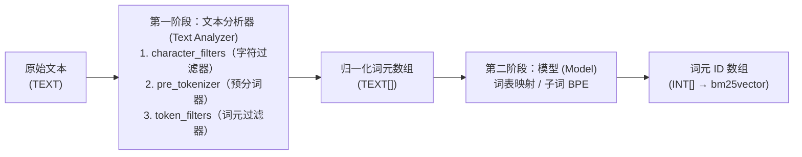

## 两阶段分词流水线 {#two-stage-tokenization-pipeline}

在 `pg_tokenizer` 中，一个分词器（`tokenizer`）最多由两个阶段组成，负责将原始 `TEXT` 字符串转换为由整数词元 ID 构成的 `INT[]` 数组：



1. **文本分析器（`text_analyzer`）**：按顺序应用以下三级流水线，将原始文本切分为归一化后的字符串词元数组 `TEXT[]`：
   - **字符过滤器（`character_filters`）**：在切分前对原始字符串进行整体转换（例如 `to_lowercase` 小写转换、`unicode_normalization` Unicode 规范化）。
   - **预分词器（`pre_tokenizer`）**：将字符串初步切分为子串（支持 `unicode_segmentation`、`regex` 正则或中文 `jieba` 分词）。
   - **词元过滤器（`token_filters`）**：对单个词元进行过滤或转换（支持 `skip_non_alphanumeric`、`stemmer` 词干提取、`stopwords` 停用词、`synonym` 同义词、`pg_dict`、以及 `ngram`）。
2. **分词模型（`model`）**：将归一化后的字符串词元（或对于 `llmlingua2`、`bert_base_uncased`、`gemma2b`、HuggingFace 及 `lindera` 等独立子词模型，直接将原始文本）映射为整数词元 ID（`INT[]`）。

> [!NOTE]
> - **预训练子词模型**（`llmlingua2`、`bert_base_uncased`、`gemma2b`）、**HuggingFace 模型**和 **Lindera 模型**已内置完整的分词规则，不需要（也不允许）配置单独的 `text_analyzer` 阶段。
> - **词典/语料模型**（`wiki_tocken` 以及通过 `create_custom_model` 创建的自定义模型）则必须搭配 `text_analyzer` 阶段，先完成文本切分与归一化，再去模型的词表（Vocabulary Table）中查找词元 ID。

## 创建与使用分词器 {#creating-and-using-a-tokenizer}

`pg_tokenizer` 中的所有配置均采用 **TOML** 格式，并通过美元符号引用的字符串（`$$ ... $$`）传入。

### 方式一：单阶段分词器（使用内置模型） {#option-1-single-stage-tokenizer-built-in-model}

```sql
SELECT create_tokenizer('llm_tok', $$
model = "llmlingua2"
$$);

SELECT tokenize('PostgreSQL is an object-relational database system.', 'llm_tok');
```

### 方式二：内联文本分析器 + 模型 {#option-2-inline-text-analyzer--model}

你可以直接在 `create_tokenizer` 内部定义 `text_analyzer` 流水线：

```sql
SELECT create_tokenizer('wiki_eng', $$
model = "wiki_tocken"

[text_analyzer.character_filters.to_lowercase]
[text_analyzer.pre_tokenizer.unicode_segmentation]
[[text_analyzer.token_filters.stopwords]]
words = "nltk_english"
[[text_analyzer.token_filters.stemmer]]
kind = "english_porter2"
$$);

SELECT tokenize('PostgreSQL is an object-relational database system.', 'wiki_eng');
```

### 方式三：可复用的命名文本分析器 + 自定义模型 {#option-3-reusable-named-text-analyzer--custom-model}

你可以使用 `create_text_analyzer` 先创建一个独立的命名 `text_analyzer`，随后在多个自定义模型和分词器之间复用它：

```sql
-- 1. 创建可复用的文本分析器
SELECT create_text_analyzer('english_analyzer', $$
[character_filters.to_lowercase]
[pre_tokenizer.unicode_segmentation]
[[token_filters.skip_non_alphanumeric]]
[[token_filters.stopwords]]
words = "nltk_english"
[[token_filters.stemmer]]
kind = "english_porter2"
$$);

-- 预览文本分析器如何将文本切分为 TEXT[] 词元数组：
SELECT apply_text_analyzer('PostgreSQL is a powerful database system!', 'english_analyzer');
-- 输出：{postgresql,power,databas,system}
```

## 管理分词器 {#managing-tokenizers}

```sql
-- 查看已配置的分词器列表
SELECT name FROM tokenizer_catalog.tokenizer;

-- 删除指定分词器
SELECT drop_tokenizer('wiki_eng');
```
