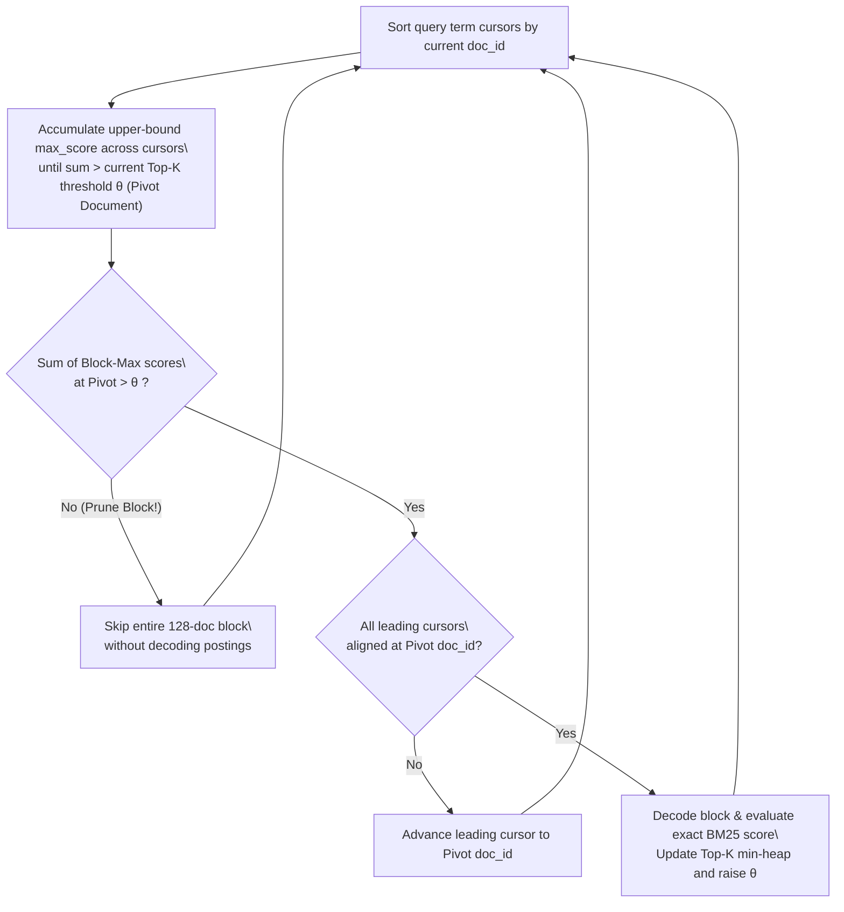

This page details the exact scoring equations and data structures implemented in `vchord_bm25` (`crates/bm25/src/bm25.rs` and `src/algorithm/block_wand.rs`).

## 1. Okapi BM25 Scoring Formula

Given a document \(D\) and a query \(Q = \\{q_1, q_2, \\dots, q_m\\}\) with query term frequencies \(c(q_i, Q)\) and document term frequencies \(f(q_i, D)\), `vchord_bm25` computes:

$$\\text{BM25}(D, Q) = \\sum_{q_i \\in Q \\cap D} c(q_i, Q) \\cdot \\text{IDF}(q_i) \\cdot \\text{TF}(q_i, D)$$

### Inverse Document Frequency (\(\text{IDF}\))

$$\\text{IDF}(q_i) = \\ln\\left(\\frac{N + 1.0}{n(q_i) + 0.5}\\right)$$

where:
- \(N\) is the total number of indexed documents in the table.
- \(n(q_i)\) is the number of documents containing token \(q_i\) (document frequency).

### Saturated Term Frequency (\(\text{TF}\))

$$\\text{TF}(q_i, D) = \\frac{f(q_i, D) \\cdot (k_1 + 1)}{f(q_i, D) + k_1 \\cdot \\left(1 - b + b \\cdot \\frac{\\hat{|D|}}{\\text{avgdl}}\\right)}$$

where:
- \(f(q_i, D)\) is the term frequency of token \(q_i\) in document \(D\).
- \(\\hat{|D|}\) is the quantized document length (total token count in \(D\)) decoded from its 1-byte `fieldnorm` ID.
- \(\\text{avgdl}\) is the average document length across all indexed documents.
- \(k_1 \\in [1.2, 2.0]\) (default **`1.2`**) controls term frequency saturation.
- \(b \\in [0.0, 1.0]\) (default **`0.75`**) controls document length normalization.

## 2. 1-Byte Fieldnorm Quantization (`FIELDNORM_TO_LENGTH`)

Storing a 32-bit float or integer length for every document and computing floating-point division for every scored posting would consume excessive memory bandwidth and CPU cycles. Instead, `vchord_bm25` quantizes document length \(|D|\) into a single byte (`u8`, `0..=255`) using the 256-entry `FIELDNORM_TO_LENGTH` lookup table:

- **Exact for short documents (`0` – `40` tokens)**: Values `0..=40` map 1:1 to exact token counts.
- **Logarithmically stepped for longer documents (`41` – `255`)**: Steps widen progressively (e.g., `42, 44, 46, ...` up to `2,013,265,944` tokens).
- **256-Entry Precomputed Score Cache**: Because `fieldnorm` has only 256 possible values, `vchord_bm25` precomputes the denominator term for all 256 possible document lengths once per query term:

$$s_0(q_i) = \\text{IDF}(q_i) \\cdot (k_1 + 1), \\qquad s_1[\\text{fn}] = k_1 \\cdot \\left(1 - b + b \\cdot \\frac{\\text{FIELDNORM\\_TO\\_LENGTH}[\\text{fn}]}{\\text{avgdl}}\\right)$$

Scoring a candidate posting during scan execution reduces to a single table lookup and one division:

$$\\text{score}(q_i, D) = \\frac{f(q_i, D) \\cdot s_0(q_i)}{f(q_i, D) + s_1[\\text{fieldnorm}(D)]}$$

## 3. Posting List Compression & Block-WeakAnd (Block-Max WAND)

### Fixed 128-Document Blocks with Delta-Bitpacking

For each term in a sealed segment, the inverted list of `(doc_id, term_frequency)` pairs is partitioned into fixed blocks of **128 documents** and compressed with **Delta-Bitpacking**:

1. Document IDs within a block are sorted in ascending order and stored as deltas (\(\Delta_i = \text{doc}_i - \text{doc}_{i-1}\)), bitpacked using the minimum bit width required by the largest delta in the block.
2. Each block header stores the **last document ID** in the block (for fast shallow seeking) and the **Block-Max TF / Fieldnorm pair** $(\text{tf}_{\\max}, \\text{fn}_{\\min})$ that achieves the highest possible BM25 contribution inside that 128-document block.

### Block-WeakAnd Top-K Pruning Loop

During an `ORDER BY vec <&> to_bm25query(...) LIMIT K` scan:

1. **Pivot Selection**: Query term cursors are ordered by their current `doc_id`. Starting from the first cursor, `vchord_bm25` sums each term's global upper-bound `max_score` until the cumulative sum exceeds the current \(K\)-th best score threshold \(\theta\) in the Top-K min-heap. The cursor where the sum crosses \(\theta\) defines the **pivot document**.
2. **Block-Max Refinement**: Without decompressing any posting block, `vchord_bm25` shallow-seeks each cursor up to the pivot's 128-document block and sums the tighter **per-block upper bounds** (`block_max_score`).
3. **Fast Block Skipping**: If the sum of `block_max_score` values is \(\le \theta\), no document in the current block intersection can possibly enter the Top-K results—the scanner immediately jumps past the block without decoding document IDs or frequencies.
4. **Exact Evaluation**: Only when the block upper bound exceeds \(\theta\) and cursors align on `pivot_doc` does `vchord_bm25` decode the block, verify visibility/deletion bitmap (and optional prefilter), compute the exact BM25 score, and update the Top-K heap.
