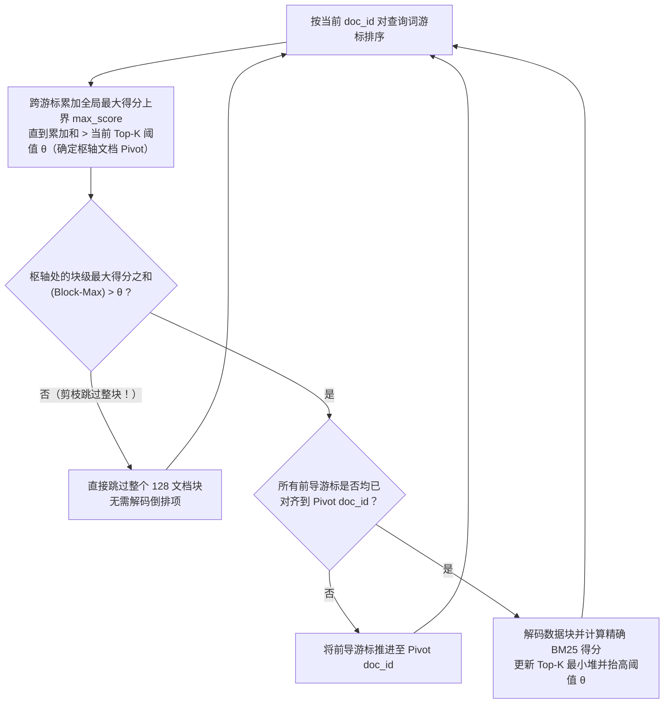

本页详细介绍 `vchord_bm25`（位于 `crates/bm25/src/bm25.rs` 与 `src/algorithm/block_wand.rs`）中实现的精确评分公式与底层数据结构。

## 1. Okapi BM25 评分公式 {#1-okapi-bm25-scoring-formula}

给定一篇文档 \(D\) 和一个查询 \(Q = \{q_1, q_2, \dots, q_m\}\)，其中查询词频为 \(c(q_i, Q)\)，文档内词频为 \(f(q_i, D)\)，`vchord_bm25` 按如下公式计算相关性得分：

$$\text{BM25}(D, Q) = \sum_{q_i \in Q \cap D} c(q_i, Q) \cdot \text{IDF}(q_i) \cdot \text{TF}(q_i, D)$$

### 逆文档频率（\(\text{IDF}\)） {#inverse-document-frequency-textidf}

$$\text{IDF}(q_i) = \ln\left(\frac{N + 1.0}{n(q_i) + 0.5}\right)$$

其中：
- \(N\) 为表中已索引文档的总数。
- \(n(q_i)\) 为包含词元 \(q_i\) 的文档数量（即文档频率 DF）。

### 饱和词频（\(\text{TF}\)） {#saturated-term-frequency-texttf}

$$\text{TF}(q_i, D) = \frac{f(q_i, D) \cdot (k_1 + 1)}{f(q_i, D) + k_1 \cdot \left(1 - b + b \cdot \frac{\hat{|D|}}{\text{avgdl}}\right)}$$

其中：
- \(f(q_i, D)\) 为词元 \(q_i\) 在文档 \(D\) 中出现的词频。
- \(\hat{|D|}\) 为从单字节 `fieldnorm` ID 解码得到的量化文档长度（文档 \(D\) 中的总词元数）。
- \(\text{avgdl}\) 为所有已索引文档的平均文档长度。
- \(k_1 \in [1.2, 2.0]\)（默认值为 **`1.2`**）用于控制词频饱和度。
- \(b \in [0.0, 1.0]\)（默认值为 **`0.75`**）用于控制文档长度归一化强度。

## 2. 单字节 Fieldnorm 量化（`FIELDNORM_TO_LENGTH`） {#2-1-byte-fieldnorm-quantization-fieldnorm_to_length}

如果为每篇文档都存储 32 位浮点数或整数长度，并在对每个倒排项评分时执行浮点除法，将消耗大量的内存带宽和 CPU 周期。为此，`vchord_bm25` 使用包含 256 个表项的 `FIELDNORM_TO_LENGTH` 查找表，将文档长度 \(|D|\) 量化为单个字节（`u8`，`0..=255`）：

- **短文档精确表示（`0` – `40` 个词元）**：取值 `0..=40` 与真实词元数量呈 1:1 精确映射。
- **长文档对数步长增长（`41` – `255`）**：步长随长度呈对数级递增（例如 `42, 44, 46, ...`，最高可覆盖 `2,013,265,944` 个词元）。
- **256 项预计算得分缓存**：由于 `fieldnorm` 只有 256 种可能取值，`vchord_bm25` 会在查询开始时针对每个查询词预先计算出全部 256 种可能文档长度的分母项：

$$s_0(q_i) = \text{IDF}(q_i) \cdot (k_1 + 1), \qquad s_1[\text{fn}] = k_1 \cdot \left(1 - b + b \cdot \frac{\text{FIELDNORM\_TO\_LENGTH}[\text{fn}]}{\text{avgdl}}\right)$$

如此一来，在索引扫描期间为候选倒排项打分就简化为一次查表与一次浮点除法：

$$\text{score}(q_i, D) = \frac{f(q_i, D) \cdot s_0(q_i)}{f(q_i, D) + s_1[\text{fieldnorm}(D)]}$$

## 3. 倒排链压缩与 Block-WeakAnd（Block-Max WAND） {#3-posting-list-compression--block-weakand-block-max-wand}

### 基于差分位打包（Delta-Bitpacking）的 128 文档定长块 {#fixed-128-document-blocks-with-delta-bitpacking}

对于封闭段（Sealed Segment）中的每个词项，由 `(doc_id, term_frequency)` 组成的倒排链表会被划分为每块 **128 篇文档**的定长块，并采用**差分位打包（Delta-Bitpacking）**进行压缩：

1. 块内文档 ID 按升序排列，存储相邻文档 ID 的差值（\(\Delta_i = \text{doc}_i - \text{doc}_{i-1}\)），并按块内最大差值所需的最小位宽进行位打包。
2. 每个块头记录该块的**最后一个文档 ID**（用于快速浅层跳转查找，Shallow Seek）以及能够在当前 128 文档块内产生最高 BM25 分数贡献的**块内最大词频 / 最短长度对** $(\text{tf}_{\max}, \text{fn}_{\min})$。

### Block-WeakAnd Top-K 剪枝循环 {#block-weakand-top-k-pruning-loop}

在执行 `ORDER BY vec <&> to_bm25query(...) LIMIT K` 扫描期间：

1. **枢轴选择（Pivot Selection）**：所有查询词游标按其当前指向的 `doc_id` 升序排列。从第一个游标开始，`vchord_bm25` 依次累加各词项的全局得分上界 `max_score`，直到累加和超过 Top-K 最小堆中当前的第 \(K\) 高分阈值 \(\theta\)。使累加和跨过 \(\theta\) 的那个游标所指向的文档即被选为**枢轴文档（Pivot Document）**。
2. **块级上界精化（Block-Max Refinement）**：在不解压任何倒排块的前提下，`vchord_bm25` 将前导游标浅层定位（Shallow Seek）到枢轴所在的 128 文档块，并累加更紧致的**块级得分上界**（`block_max_score`）。
3. **快速跳块（Fast Block Skipping）**：如果各游标的 `block_max_score` 之和 \(\le \theta\)，说明当前块交集中的任何文档都不可能进入 Top-K 结果——扫描器会直接跳过该块，完全不必解码文档 ID 或词频数据。
4. **精确求值（Exact Evaluation）**：只有当块级上界之和超过 \(\theta\) 且所有前导游标均对齐到 `pivot_doc` 时，`vchord_bm25` 才会解码该数据块、检查 MVCC 可见性/删除位图（以及可选的预过滤条件）、计算精确的 BM25 得分，并更新 Top-K 最小堆。
