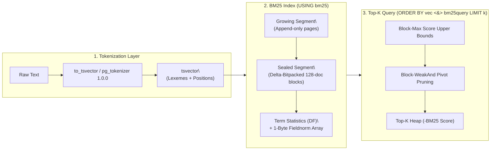

PostgreSQL includes built-in full-text search via `tsvector`, `tsquery`, `ts_rank`, and `GIN` indexes. While effective for boolean keyword matching (`@@`), PostgreSQL's built-in ranking has two structural limitations for modern search and Retrieval-Augmented Generation (RAG) workloads:

1. **Suboptimal Ranking Formula (`ts_rank`)**: PostgreSQL's `ts_rank` and `ts_rank_cd` do not track corpus-wide **Inverse Document Frequency (IDF)** or **Average Document Length (\(\text{avgdl}\))** across the index. Common words are weighted the same as rare, high-signal terms, and term frequency is not properly saturated.
2. **Exhaustive Index Scans on `ORDER BY ... LIMIT K`**: A PostgreSQL `GIN` index only accelerates boolean matching (`WHERE tsv @@ tsquery`). To return the Top-10 highest-ranked documents, PostgreSQL must fetch **every** matching row from the heap, compute `ts_rank` for all of them, and sort the entire result set.

## How VectorChord-BM25 Solves Both Problems

**VectorChord-BM25 (`vchord_bm25`)** introduces a dedicated PostgreSQL index access method (`USING bm25`) and sparse BM25 scoring operator (`<&>`) specifically engineered for Top-K lexical retrieval:

| Capability | PostgreSQL Built-in (`GIN` + `ts_rank`) | VectorChord-BM25 (`vchord_bm25`) |
| :--- | :--- | :--- |
| **Ranking Model** | Local term frequency / proximity (`ts_rank`) | Corpus-wide **Okapi BM25** (\(\text{IDF}\), \(k_1\), \(b\), \(\text{avgdl}\)) |
| **Top-K Execution** | Fetch & score **all** matching tuples, then sort | **Block-WeakAnd (Block-Max WAND)** early pruning inside the index |
| **Posting Compression** | Uncompressed or basic varint TID lists | SIMD-friendly **Delta-Bitpacking** in 128-doc blocks |
| **Document Length Norm** | Optional crude bitmask flags | 1-byte **Fieldnorm Quantization** (256-entry lookup table) |
| **Query Semantics** | Boolean `AND`/`OR` match required | Non-conjunctive Top-K ranking across all query terms |
| **Tokenization** | Built-in `ts_debug` / Snowball | `pg_tokenizer` (LLM tokenizers, `jieba`, `lindera`, custom vocab) or native `tsvector` |
{.wide .expand}

## Architecture Overview

## Two API Generations

When working with `vchord_bm25`, be aware of the two API generations across releases:

1. **Historical Releases (`v0.1.0` – `v0.3.0`, schema `bm25_catalog`)**:
   - Uses custom data types `bm25vector` (sparse `token_id:frequency` map, e.g., `{1:1, 2:2}`) and `bm25query`.
   - Pairs with the **[`pg_tokenizer`](/docs/tokenizer/)** extension (`tokenizer_catalog`), which converts text into `INT[]` token ID arrays that cast implicitly to `bm25vector`.
   - Index creation: `CREATE INDEX idx ON documents USING bm25 (embedding bm25_ops);`
   - Query construction: `to_bm25query('idx', tokenize('query text', 'tokenizer_name'))`

2. **Native `tsvector` Architecture (`1.0.0`)**:
   - Operates directly on PostgreSQL's built-in **`tsvector`** data type (`CREATE OPERATOR CLASS bm25_ops FOR TYPE tsvector USING bm25`), removing the requirement for a separate `bm25vector` column.
   - Index creation: `CREATE INDEX idx ON documents USING bm25 (vector bm25_ops);`
   - Query construction: `to_bm25query(to_tsvector('english', 'query text'), 'idx')`

> [!TIP]
> New deployments should use the 1.0.0 `tsvector` workflow. Examples labeled 0.1–0.3 are retained for historical deployments; see the [migration guide](/docs/bm25/reference/migration/).
