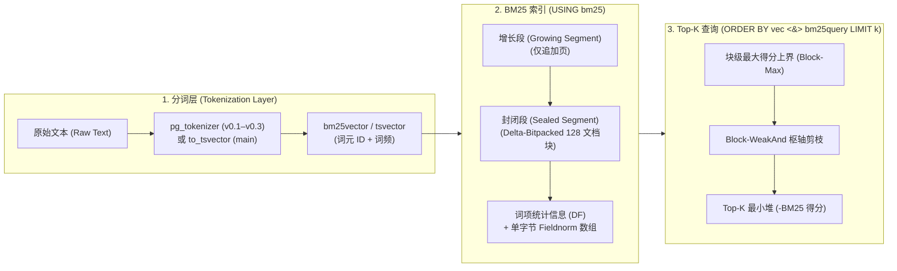

PostgreSQL 通过 `tsvector`、`tsquery`、`ts_rank` 和 `GIN` 索引提供了内置的全文检索能力。虽然它在布尔关键词匹配（`@@`）方面表现良好，但在现代搜索与检索增强生成（RAG）工作负载下，PostgreSQL 内置的相关性排序存在两个结构性局限：

1. **排序公式不理想（`ts_rank`）**：PostgreSQL 的 `ts_rank` 和 `ts_rank_cd` 不会在索引中维护全语料库级别的**逆文档频率（IDF）**或**平均文档长度（\(\text{avgdl}\)）**。常见词与罕见的高信息量词被赋予相同的权重，且词频（TF）缺乏合理的饱和度控制。
2. **`ORDER BY ... LIMIT K` 必须全量扫描**：PostgreSQL 的 `GIN` 索引只能加速布尔匹配（`WHERE tsv @@ tsquery`）。为了返回得分最高的 Top-10 文档，PostgreSQL 必须从堆表（Heap）中取出**所有**匹配行，逐一计算 `ts_rank`，再对整个结果集进行排序。

## VectorChord-BM25 如何解决这两个问题 {#how-vectorchord-bm25-solves-both-problems}

**VectorChord-BM25 (`vchord_bm25`)** 引入了专为 Top-K 词法检索设计的 PostgreSQL 索引访问方法（`USING bm25`）和稀疏 BM25 评分操作符（`<&>`）：

| 能力维度 | PostgreSQL 内置 (`GIN` + `ts_rank`) | VectorChord-BM25 (`vchord_bm25`) |
| :--- | :--- | :--- |
| **排序模型** | 局部词频 / 词距 (`ts_rank`) | 全语料库 **Okapi BM25**（\(\text{IDF}\)、\(k_1\)、\(b\)、\(\text{avgdl}\)） |
| **Top-K 执行方式** | 取出并计算**所有**匹配元组后再排序 | 索引内 **Block-WeakAnd (Block-Max WAND)** 提前剪枝 |
| **倒排链压缩** | 未压缩或基础变长整数 TID 列表 | 128 文档分块、对 SIMD 友好的**差分位打包（Delta-Bitpacking）** |
| **文档长度归一化** | 可选的粗粒度位掩码标志 | 单字节 **Fieldnorm 量化**（256 项查找表） |
| **查询语义** | 要求布尔 `AND`/`OR` 精确匹配 | 跨所有查询词的非合取（Non-conjunctive）Top-K 相关性排序 |
| **分词能力** | 内置 `ts_debug` / Snowball | `pg_tokenizer`（LLM 分词器、`jieba`、`lindera`、自定义词表）或原生 `tsvector` |
{.wide .expand}

## 架构概览 {#architecture-overview}

## 两代 API 演进 {#two-api-generations}

在使用 `vchord_bm25` 时，请注意不同版本间的两代 API 设计：

1. **稳定发布版（`v0.1.0` – `v0.3.0`，模式 `bm25_catalog`）**：
   - 使用自定义数据类型 `bm25vector`（稀疏的 `token_id:frequency` 映射，例如 `{1:1, 2:2}`）和 `bm25query`。
   - 配合 **[`pg_tokenizer`](/zh/docs/tokenizer/)** 扩展（`tokenizer_catalog`）使用，将文本转换为 `INT[]` 词元 ID 数组，并可隐式转换为 `bm25vector`。
   - 创建索引：`CREATE INDEX idx ON documents USING bm25 (embedding bm25_ops);`
   - 构造查询：`to_bm25query('idx', tokenize('query text', 'tokenizer_name'))`

2. **新一代原生 `tsvector` 架构（`main` 分支）**：
   - 直接作用于 PostgreSQL 内置的 **`tsvector`** 数据类型（`CREATE OPERATOR CLASS bm25_ops FOR TYPE tsvector USING bm25`），无需额外维护单独的 `bm25vector` 列。
   - 创建索引：`CREATE INDEX idx ON documents USING bm25 (vector bm25_ops) WITH (options = $$ k1 = 1.2, b = 0.75 $$);`
   - 构造查询：`to_bm25query(to_tsvector('english', 'query text'), 'idx')`

> [!TIP]
> 本指南在各章节中均并列提供了这两种工作流的完整示例，你可以根据实际部署的版本直接选用对应的写法。
