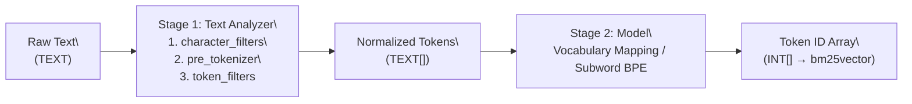

## Two-Stage Tokenization Pipeline

A `tokenizer` in `pg_tokenizer` consists of up to two stages that transform a raw `TEXT` string into an `INT[]` array of integer token IDs:



1. **Text Analyzer (`text_analyzer`)**: Splits raw text into a `TEXT[]` array of normalized string tokens by applying a sequential pipeline of:
   - **Character Filters (`character_filters`)**: Transform the raw string before splitting (e.g., `to_lowercase`, `unicode_normalization`).
   - **Pre-tokenizer (`pre_tokenizer`)**: Splits the string into initial substrings (`unicode_segmentation`, `regex`, or Chinese `jieba`).
   - **Token Filters (`token_filters`)**: Filter or transform individual tokens (`skip_non_alphanumeric`, `stemmer`, `stopwords`, `synonym`, `pg_dict`, `ngram`).
2. **Model (`model`)**: Maps the string tokens (or raw text, for standalone subword models like `llmlingua2`, `bert_base_uncased`, `gemma2b`, HuggingFace, or `lindera`) into integer token IDs (`INT[]`).

> [!NOTE]
> - **Pretrained subword models** (`llmlingua2`, `bert_base_uncased`, `gemma2b`), **HuggingFace models**, and **Lindera models** include their own built-in tokenization rules and do not require a separate `text_analyzer` stage.
> - **Dictionary/corpus models** (`wiki_tocken` and custom models created via `create_custom_model`) require a `text_analyzer` stage to split and normalize text before looking up token IDs in the model's vocabulary table.

## Creating and Using a Tokenizer

All configuration in `pg_tokenizer` uses **TOML** format passed as a dollar-quoted string (`$$ ... $$`).

### Option 1: Single-Stage Tokenizer (Built-in Model)

```sql
SELECT create_tokenizer('llm_tok', $$
model = "llmlingua2"
$$);

SELECT tokenize('PostgreSQL is an object-relational database system.', 'llm_tok');
```

### Option 2: Inline Text Analyzer + Model

You can define the `text_analyzer` pipeline directly inside `create_tokenizer`:

```sql
SELECT create_tokenizer('wiki_eng', $$
model = "wiki_tocken"

[text_analyzer.character_filters.to_lowercase]
[text_analyzer.pre_tokenizer.unicode_segmentation]
[[text_analyzer.token_filters.stopwords]]
words = "nltk_english"
[[text_analyzer.token_filters.stemmer]]
kind = "english_porter2"
$$);

SELECT tokenize('PostgreSQL is an object-relational database system.', 'wiki_eng');
```

### Option 3: Reusable Named Text Analyzer + Custom Model

You can create a standalone `text_analyzer` once with `create_text_analyzer` and reference it across multiple custom models and tokenizers:

```sql
-- 1. Create a reusable text analyzer
SELECT create_text_analyzer('english_analyzer', $$
[character_filters.to_lowercase]
[pre_tokenizer.unicode_segmentation]
[[token_filters.skip_non_alphanumeric]]
[[token_filters.stopwords]]
words = "nltk_english"
[[token_filters.stemmer]]
kind = "english_porter2"
$$);

-- Preview how the text analyzer splits text into TEXT[] tokens:
SELECT apply_text_analyzer('PostgreSQL is a powerful database system!', 'english_analyzer');
-- Output: {postgresql,power,databas,system}
```

## Managing Tokenizers

```sql
-- List configured tokenizers
SELECT name FROM tokenizer_catalog.tokenizer;

-- Drop a tokenizer
SELECT drop_tokenizer('wiki_eng');
```

## Native PostgreSQL full-text search (0.1.2, unreleased)

Version 0.1.2 adds two functions returning the native `tsvector` type. `analyze_to_tsvector` uses the text analyzer's string tokens as lexemes, making it useful for Jieba and custom stemmer/filter pipelines. `tokenize_to_tsvector` instead uses the model's token IDs as decimal lexemes, supporting built-in, custom, Hugging Face, and Lindera models. No model decoding or second PostgreSQL text normalization is performed.

```sql
SELECT create_text_analyzer('fts_words', $$
pre_tokenizer = "unicode_segmentation"
[[character_filters]]
to_lowercase = {}
$$);
SELECT analyze_to_tsvector('Cat dog cat', 'fts_words');
-- 'cat':1,3 'dog':2

CREATE TABLE fts_documents (id int PRIMARY KEY, passage text, terms tsvector);
INSERT INTO fts_documents VALUES
    (1, 'Cat dog cat', analyze_to_tsvector('Cat dog cat', 'fts_words'));
CREATE INDEX ON fts_documents USING gin (terms);
SELECT id FROM fts_documents WHERE terms @@ 'cat <-> dog'::tsquery;

SELECT create_tokenizer('fts_bert', 'model = "bert_base_uncased"');
SELECT tokenize_to_tsvector('hello hello', 'fts_bert');
-- '7592':1,2
```

Both functions preserve repeated output tokens and assign positions from the final output sequence (default weight D). Positions are **not source-text offsets**: filters can remove, expand, or reorder tokens, and model output can contain subwords. Quotes, backslashes, whitespace, and punctuation in lexemes are preserved. Empty tokens are omitted; an empty output produces an empty vector, and NULL input returns NULL.

PostgreSQL's native limits apply: lexemes must be shorter than 2 KB, each lexeme stores at most 256 positions, and positions above 16,383 are clamped. Long input can therefore lose term-frequency/proximity detail. See [PostgreSQL text search limits](https://www.postgresql.org/docs/current/textsearch-limitations.html).

Use the same analyzer/model and lexeme representation for documents and queries. `plainto_tsquery('english', ...)` does not generate model token IDs or reproduce a custom Chinese analyzer. These functions do not add a custom text search parser or a `tsquery` builder. They are `STABLE` because definitions live in catalogs: store/update the resulting vector in a column and index that column with GIN/GiST. When an installed BM25 implementation accepts native `tsvector`, it can consume these values too; check that implementation's SQL API before migrating an existing `bm25vector` index.
