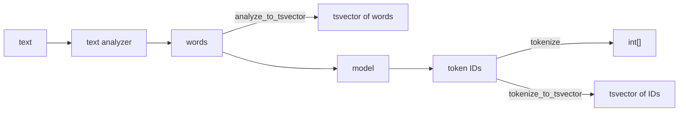

PostgreSQL's `to_tsvector` splits text at spaces and punctuation, so it cannot find the words in Chinese or Japanese text, and its dictionaries give you limited control over stopwords, synonyms and stemming. pg_tokenizer runs a pipeline you configure in SQL and returns a `tsvector` that [vchord_bm25](/docs/bm25/) ranks with BM25, or the integer token IDs of a vocabulary such as an LLM tokenizer. If `to_tsvector('english', ...)` already handles your text, you do not need it.

## How it works {#how-it-works}

<a id="two-stage-tokenization-pipeline"></a>

Text passes through up to two stages:



1. A **text analyzer** decides what counts as a word. Character filters rewrite the whole text (lowercase, Unicode normalization), a pre-tokenizer splits it (at Unicode word boundaries, by a regular expression, or with the jieba dictionary for Chinese), and token filters drop or rewrite words (stopwords, stemming, synonyms, PostgreSQL dictionaries, n-grams).
1. A **model** maps text to integer IDs from a fixed vocabulary: one of four built-in LLM vocabularies, a Hugging Face `tokenizer.json`, a Lindera dictionary for Japanese or Korean, or a vocabulary built from one of your tables.
{.steps}

An analyzer alone is enough for BM25: `analyze_to_tsvector` makes the words themselves the lexemes. To use a model you create a **tokenizer**, which pairs the model with an optional analyzer; `tokenize` returns its IDs as `int[]`, and `tokenize_to_tsvector` returns them as lexemes.

## Choose a path {#choose}

| You want | Create | Then call |
| --- | --- | --- |
| BM25 search on English or another language with spaces | text analyzer with a stemmer | `analyze_to_tsvector` |
| BM25 search on Chinese | text analyzer with the `jieba` pre-tokenizer | `analyze_to_tsvector` |
| BM25 search on Japanese or Korean | Lindera model and a tokenizer | `tokenize_to_tsvector` |
| The same token IDs as an LLM or embedding model | tokenizer with a built-in or Hugging Face model | `tokenize` |
| Compact integer IDs for the words of your own corpus | tokenizer with a custom model | `tokenize` |

You need a model only when you need IDs, or when splitting the text needs a dictionary that only a model provides, as Japanese does. [Multilingual recipes](/docs/tokenizer/multilingual/) has a complete setup for English, other European languages, Chinese and Japanese.

## Quick start {#quick-start}

This builds BM25 search over English text. It needs pg_tokenizer and vchord_bm25 installed; see [Installation](/docs/tokenizer/installation/).

1. Preload both libraries and restart PostgreSQL. Keep any libraries already in the list.

   ```sql
   ALTER SYSTEM SET shared_preload_libraries = 'pg_tokenizer, vchord_bm25';
   ```

1. Create the extensions:

   ```sql
   CREATE EXTENSION IF NOT EXISTS pg_tokenizer;
   CREATE EXTENSION IF NOT EXISTS vchord_bm25;
   ```

1. Create a text analyzer that lowercases, splits at word boundaries, removes English stopwords and stems, then look at what it produces:

   ```sql
   SELECT tokenizer_catalog.create_text_analyzer('en_text', $$
   character_filters = ["to_lowercase"]
   pre_tokenizer = "unicode_segmentation"
   token_filters = [
       { stopwords = "nltk_english" },
       { stemmer = "english_porter2" },
   ]
   $$);

   SELECT tokenizer_catalog.analyze_to_tsvector('The quick brown foxes jumped', 'en_text');
   ```

   ```text
   'brown':2 'fox':3 'jump':4 'quick':1
   ```

1. Store the analyzed text in a `tsvector` column, index it, and rank with the same analyzer on the query:

   ```sql
   CREATE TABLE docs (
       id bigint GENERATED ALWAYS AS IDENTITY PRIMARY KEY,
       body text NOT NULL,
       terms tsvector
   );

   INSERT INTO docs (body) VALUES
       ('The quick brown fox jumps over the lazy dog.'),
       ('Foxes are quick to adapt to cities.'),
       ('A slow brown bear sleeps all winter.');

   UPDATE docs SET terms = tokenizer_catalog.analyze_to_tsvector(body, 'en_text');

   CREATE INDEX docs_terms_bm25 ON docs USING bm25 (terms bm25_ops);

   SELECT id, body
   FROM docs
   ORDER BY terms <&> to_bm25query(
       tokenizer_catalog.analyze_to_tsvector('quick foxes', 'en_text'),
       'docs_terms_bm25')
   LIMIT 10;
   ```
{.steps}

`<&>` returns the negated BM25 score, so ascending order puts the best match first. To keep `terms` current as rows change, add the trigger shown in the [English recipe](/docs/tokenizer/multilingual/#english).

## Output {#output}

<a id="native-postgresql-full-text-search"></a><a id="native-fts"></a>

Both `tsvector` functions number the words in the order the pipeline outputs them, starting at 1, with the default weight `D`. A repeated word becomes one lexeme with several positions. Positions count output words, not characters in the source text, so a word removed by a stopword filter leaves no gap.

The result is an ordinary `tsvector`. vchord_bm25 reads the term counts and document length from it; GIN indexes and `@@` also work, as long as the `tsquery` holds the same lexemes. `to_tsquery('english', ...)` produces different lexemes, so build the query side with the same analyzer or tokenizer as the documents.

## Limits {#limits}

<a id="operational-notes--known-limitations"></a>

These apply whichever path you choose.

- **Not in generated columns or expression indexes.** `analyze_to_tsvector`, `tokenize_to_tsvector`, `tokenize` and `apply_text_analyzer` read their definitions from tables, so they are `STABLE`, not `IMMUTABLE`. PostgreSQL rejects them in `GENERATED ALWAYS AS (...) STORED` with `generation expression is not immutable`, and in an index expression with `functions in index expression must be marked IMMUTABLE`. Store the result in an ordinary column filled by `INSERT`, `UPDATE`, or a trigger.
- **Documents and queries must use the same definition.** A query analyzed differently from the documents matches little or nothing.
- **Stored values are never recomputed.** Dropping and recreating an analyzer, tokenizer or model under the same name changes future output only. Recompute the stored column with an `UPDATE`; see [Change an analyzer in use](/docs/tokenizer/text-analyzer/#change). A trigger or tokenizer that names a dropped analyzer fails with `TextAnalyzer not found: <name>`.
- **Definitions belong to one database.** Analyzers, tokenizers, models, stopword lists and synonym lists live in tables in the database where you create them, and replicate and dump with it. Create them in each database that needs them.
- **`tsvector` limits.** A word longer than 2,046 bytes is left out. A lexeme keeps at most 256 positions, and positions above 16,383 all become 16,383, so in documents longer than about 16,000 words, later occurrences stop adding to term counts; split very long documents into passages if ranking them matters. If the distinct lexemes of one document exceed about 1 MB, the call fails with `string is too long for tsvector`.
- **Size limits per call.** By default one call accepts up to 16 MiB of text, and a jieba, regular-expression or model step receives at most 1 MiB at a time. When an input splits as one piece, as it does with jieba or with a model that has no analyzer in front, a document over 1 MiB fails with `pg_tokenizer exceeds max_piece_bytes (1048576)`. Raise the [limits](/docs/tokenizer/reference/#analysis-budgets) per transaction for trusted batch loads.
- **Models use memory per backend.** Each backend loads a model on first use and keeps it. `llmlingua2` takes about 200 MB and `gemma2b` about 100 MB, in every backend that uses them unless they are [preloaded](/docs/tokenizer/models/#preload). `llmlingua2` is preloaded by default, which costs that memory at server start even if you never use it.
- **Preloading is required.** pg_tokenizer must be in `shared_preload_libraries`; otherwise `CREATE EXTENSION` fails with `pg_tokenizer must be loaded via shared_preload_libraries.` Its position in the list does not matter, but setting the list replaces it, so name every library the server needs.
- **Model names.** Model names use ASCII letters, digits and underscores, start with a letter, and have at most 20 characters. The built-in names `bert_base_uncased`, `wiki_tocken`, `gemma2b` and `llmlingua2` are reserved. Other definitions have no naming rule beyond being unique.

## Where to go next {#next-steps}

- **Set up search for a language**: [Multilingual recipes](/docs/tokenizer/multilingual/).
- **Tune what counts as a word**: [Text analyzers](/docs/tokenizer/text-analyzer/).
- **Produce token IDs, or segment Japanese and Korean**: [Models](/docs/tokenizer/models/).
- **Look up a function, key or setting**: [Reference](/docs/tokenizer/reference/).
- **Rank, filter and combine with vectors**: [vchord_bm25](/docs/bm25/) and [vchord](/docs/vchord/).

## License {#license}

pg_tokenizer is licensed under [Apache-2.0](https://github.com/pgsty/pg_tokenizer/blob/main/LICENSE). It is a fork of TensorChord's pg_tokenizer.rs, maintained by [PGSTY](https://pgsty.com).
