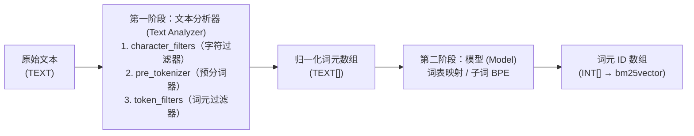

## 两阶段分词流水线 {#two-stage-tokenization-pipeline}

在 `pg_tokenizer` 中，一个分词器（`tokenizer`）最多由两个阶段组成，负责将原始 `TEXT` 字符串转换为由整数词元 ID 构成的 `INT[]` 数组：



1. **文本分析器（`text_analyzer`）**：按顺序应用以下三级流水线，将原始文本切分为归一化后的字符串词元数组 `TEXT[]`：
   - **字符过滤器（`character_filters`）**：在切分前对原始字符串进行整体转换（例如 `to_lowercase` 小写转换、`unicode_normalization` Unicode 规范化）。
   - **预分词器（`pre_tokenizer`）**：将字符串初步切分为子串（支持 `unicode_segmentation`、`regex` 正则或中文 `jieba` 分词）。
   - **词元过滤器（`token_filters`）**：对单个词元进行过滤或转换（支持 `skip_non_alphanumeric`、`stemmer` 词干提取、`stopwords` 停用词、`synonym` 同义词、`pg_dict`、以及 `ngram`）。
2. **分词模型（`model`）**：将归一化后的字符串词元（或对于 `llmlingua2`、`bert_base_uncased`、`gemma2b`、HuggingFace 及 `lindera` 等独立子词模型，直接将原始文本）映射为整数词元 ID（`INT[]`）。

> [!NOTE]
> - **预训练子词模型**（`llmlingua2`、`bert_base_uncased`、`gemma2b`）、**HuggingFace 模型**和 **Lindera 模型**已内置完整的分词规则，不需要（也不允许）配置单独的 `text_analyzer` 阶段。
> - **词典/语料模型**（`wiki_tocken` 以及通过 `create_custom_model` 创建的自定义模型）则必须搭配 `text_analyzer` 阶段，先完成文本切分与归一化，再去模型的词表（Vocabulary Table）中查找词元 ID。

## 创建与使用分词器 {#creating-and-using-a-tokenizer}

`pg_tokenizer` 中的所有配置均采用 **TOML** 格式，并通过美元符号引用的字符串（`$$ ... $$`）传入。

### 方式一：单阶段分词器（使用内置模型） {#option-1-single-stage-tokenizer-built-in-model}

```sql
SELECT create_tokenizer('llm_tok', $$
model = "llmlingua2"
$$);

SELECT tokenize('PostgreSQL is an object-relational database system.', 'llm_tok');
```

### 方式二：内联文本分析器 + 模型 {#option-2-inline-text-analyzer--model}

你可以直接在 `create_tokenizer` 内部定义 `text_analyzer` 流水线：

```sql
SELECT create_tokenizer('wiki_eng', $$
model = "wiki_tocken"
character_filters = ["to_lowercase"]
pre_tokenizer = "unicode_segmentation"
[[token_filters]]
stopwords = "nltk_english"
[[token_filters]]
stemmer = "english_porter2"
$$);

SELECT tokenize('PostgreSQL is an object-relational database system.', 'wiki_eng');
```

### 方式三：可复用的命名文本分析器 + 自定义模型 {#option-3-reusable-named-text-analyzer--custom-model}

你可以使用 `create_text_analyzer` 先创建一个独立的命名 `text_analyzer`，随后在多个自定义模型和分词器之间复用它：

```sql
-- 1. 创建可复用的文本分析器
SELECT create_text_analyzer('english_analyzer', $$
character_filters = ["to_lowercase"]
pre_tokenizer = "unicode_segmentation"
[[token_filters]]
skip_non_alphanumeric = {}
[[token_filters]]
stopwords = "nltk_english"
[[token_filters]]
stemmer = "english_porter2"
$$);

-- 预览文本分析器如何将文本切分为 TEXT[] 词元数组：
SELECT apply_text_analyzer('PostgreSQL is a powerful database system!', 'english_analyzer');
-- 输出：{postgresql,power,databas,system}
```

## 管理分词器 {#managing-tokenizers}

```sql
-- 查看已配置的分词器列表
SELECT name FROM tokenizer_catalog.tokenizer;

-- 删除指定分词器
SELECT drop_tokenizer('wiki_eng');
```

## 原生 PostgreSQL 全文检索 {#native-fts}

1.0.0 提供两个返回 PostgreSQL 原生 `tsvector` 的函数。`analyze_to_tsvector` 将文本分析器输出的字符串词元转换为词素，适合 Jieba 及自定义词干、停用词流水线；`tokenize_to_tsvector` 将模型输出的整数 ID 转为十进制词素，适用于内置、自定义、Hugging Face 和 Lindera 模型。它们不解码模型 ID，也不会再次使用 PostgreSQL 分词器归一化文本。

```sql
SELECT create_text_analyzer('fts_words', $$
pre_tokenizer = "unicode_segmentation"
[[character_filters]]
to_lowercase = {}
$$);
SELECT analyze_to_tsvector('Cat dog cat', 'fts_words');
-- 'cat':1,3 'dog':2

CREATE TABLE fts_documents (id int PRIMARY KEY, passage text, terms tsvector);
INSERT INTO fts_documents VALUES
    (1, 'Cat dog cat', analyze_to_tsvector('Cat dog cat', 'fts_words'));
CREATE INDEX ON fts_documents USING gin (terms);
SELECT id FROM fts_documents WHERE terms @@ 'cat <-> dog'::tsquery;

SELECT create_tokenizer('fts_bert', 'model = "bert_base_uncased"');
SELECT tokenize_to_tsvector('hello hello', 'fts_bert');
-- '7592':1,2
```

位置来自最终输出序列，默认权重为 D；它不代表原始文本偏移，因为过滤器会删除、展开或重排词元，模型也可能输出子词。引号、反斜杠、空白和标点会保留，空词元被忽略；空输出返回空向量，NULL 输入返回 NULL。

原生类型限制仍然适用：超过 2046 字节的词元会被跳过且不保留位置间隙，每个词素最多保存 256 个位置，超过 16,383 的位置被截到 16,383。长文本的词频与距离信息可能因此丢失，详见 [PostgreSQL 全文检索限制](https://www.postgresql.org/docs/current/textsearch-limitations.html)。

文档与查询应使用相同分析器或模型、相同词素表示；`plainto_tsquery('english', ...)` 不会生成模型 ID，也不能复现自定义中文分析器。本次不增加文本搜索解析器或 `tsquery` 构造器。两个函数因读取目录配置而标记为 `STABLE`：先将结果存入列，再为该列创建 GIN/GiST 索引。接受原生 `tsvector` 的 BM25 实现也能使用这些值；迁移旧 `bm25vector` 索引前，应核对所安装 BM25 版本的 SQL API。
