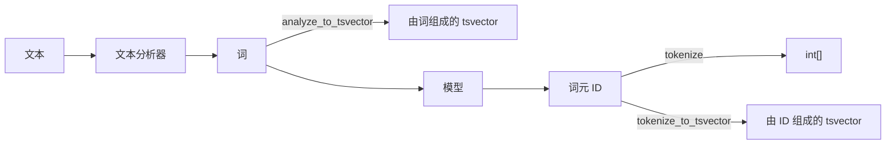

PostgreSQL 自带的 `to_tsvector` 按空格和标点切词，遇到词与词之间没有空格的中文、日文就无从下手；它的词典对停用词、同义词和词干提取的控制也很有限。pg_tokenizer 在数据库里运行一条用 SQL 配置的分词流水线，输出可供 [vchord_bm25](/zh/docs/bm25/) 做 BM25 排序的 `tsvector`，或者某个词表（比如大模型分词器）的整数词元 ID。如果 `to_tsvector('english', ...)` 已经能处理好你的文本，就不需要它。

## 工作原理 {#how-it-works}

<a id="two-stage-tokenization-pipeline"></a>

文本最多经过两个阶段：



1. **文本分析器**（text analyzer）决定什么算一个词。字符过滤器改写整段文本（转小写、Unicode 规范化），预分词器负责切分（按 Unicode 词边界、按正则表达式，或者用结巴词典切中文），词元过滤器删除或改写切出来的词（停用词、词干提取、同义词、PostgreSQL 词典、n-gram）。
1. **模型**（model）把文本映射成固定词表中的整数 ID：四个内置的大模型词表之一、Hugging Face 的 `tokenizer.json`、用于日文或韩文的 Lindera 词典，或者从你自己的表里构建的词表。
{.steps}

做 BM25 检索只要分析器就够了：`analyze_to_tsvector` 直接把词本身作为词位（lexeme）。要用模型，需要创建一个**分词器**（tokenizer），它把模型和一个可选的分析器组合在一起；`tokenize` 以 `int[]` 返回 ID，`tokenize_to_tsvector` 则把 ID 作为词位返回。

## 选择路径 {#choose}

| 目标 | 创建 | 然后调用 |
| --- | --- | --- |
| 对英文或其他以空格分词的语言做 BM25 检索 | 带词干提取的文本分析器 | `analyze_to_tsvector` |
| 对中文做 BM25 检索 | 使用 `jieba` 预分词器的文本分析器 | `analyze_to_tsvector` |
| 对日文或韩文做 BM25 检索 | Lindera 模型加一个分词器 | `tokenize_to_tsvector` |
| 与某个大模型或嵌入模型完全一致的词元 ID | 使用内置模型或 Hugging Face 模型的分词器 | `tokenize` |
| 给自己语料中的词分配紧凑的整数 ID | 使用自定义模型的分词器 | `tokenize` |

只有两种情况需要模型：你要的是 ID，或者切词所需的词典只有模型才提供（日文就是这样）。英文、其他欧洲语言、中文和日文的完整配置见[多语言配方](/zh/docs/tokenizer/multilingual/)。

## 快速上手 {#quick-start}

下面为英文文本搭建 BM25 检索。需要先装好 pg_tokenizer 和 vchord_bm25，见[安装](/zh/docs/tokenizer/installation/)。

1. 预加载两个动态库并重启 PostgreSQL。列表里已有的库要保留。

   ```sql
   ALTER SYSTEM SET shared_preload_libraries = 'pg_tokenizer, vchord_bm25';
   ```

1. 创建扩展：

   ```sql
   CREATE EXTENSION IF NOT EXISTS pg_tokenizer;
   CREATE EXTENSION IF NOT EXISTS vchord_bm25;
   ```

1. 创建一个文本分析器：转小写、按词边界切分、去掉英文停用词、提取词干。然后看看它的输出：

   ```sql
   SELECT tokenizer_catalog.create_text_analyzer('en_text', $$
   character_filters = ["to_lowercase"]
   pre_tokenizer = "unicode_segmentation"
   token_filters = [
       { stopwords = "nltk_english" },
       { stemmer = "english_porter2" },
   ]
   $$);

   SELECT tokenizer_catalog.analyze_to_tsvector('The quick brown foxes jumped', 'en_text');
   ```

   ```text
   'brown':2 'fox':3 'jump':4 'quick':1
   ```

1. 把分析结果存进 `tsvector` 列，建索引，查询时用同一个分析器处理查询文本：

   ```sql
   CREATE TABLE docs (
       id bigint GENERATED ALWAYS AS IDENTITY PRIMARY KEY,
       body text NOT NULL,
       terms tsvector
   );

   INSERT INTO docs (body) VALUES
       ('The quick brown fox jumps over the lazy dog.'),
       ('Foxes are quick to adapt to cities.'),
       ('A slow brown bear sleeps all winter.');

   UPDATE docs SET terms = tokenizer_catalog.analyze_to_tsvector(body, 'en_text');

   CREATE INDEX docs_terms_bm25 ON docs USING bm25 (terms bm25_ops);

   SELECT id, body
   FROM docs
   ORDER BY terms <&> to_bm25query(
       tokenizer_catalog.analyze_to_tsvector('quick foxes', 'en_text'),
       'docs_terms_bm25')
   LIMIT 10;
   ```
{.steps}

`<&>` 返回的是 BM25 分数的相反数，所以升序排列时最相关的行排在最前。要让 `terms` 随行的增改自动更新，加上[英文配方](/zh/docs/tokenizer/multilingual/#english)里的触发器。

## 输出 {#output}

<a id="native-postgresql-full-text-search"></a><a id="native-fts"></a>

两个返回 `tsvector` 的函数按流水线输出词的先后顺序从 1 开始编号位置，权重为默认的 `D`。重复出现的词合并成一个词位，带多个位置。位置数的是输出的词，不是原文中的字符偏移，所以被停用词过滤器删掉的词不会留下空位。

结果就是普通的 `tsvector`。vchord_bm25 从中读取词频和文档长度；GIN 索引和 `@@` 也能用，只要 `tsquery` 里是同样的词位。`to_tsquery('english', ...)` 生成的词位不一样，所以查询一侧要用与文档相同的分析器或分词器来构造。

## 限制 {#limits}

<a id="operational-notes--known-limitations"></a>

无论选哪条路径，下面这些限制都适用。

- **不能用于生成列和表达式索引。** `analyze_to_tsvector`、`tokenize_to_tsvector`、`tokenize` 和 `apply_text_analyzer` 要从表里读取定义，所以是 `STABLE` 而不是 `IMMUTABLE`。PostgreSQL 在 `GENERATED ALWAYS AS (...) STORED` 中会拒绝它们并报 `generation expression is not immutable`，在索引表达式中报 `functions in index expression must be marked IMMUTABLE`。请把结果存进普通列，由 `INSERT`、`UPDATE` 或触发器填充。
- **文档和查询必须用同一份定义。** 查询文本的分析方式与文档不同，就几乎什么都匹配不上。
- **已存储的值不会重新计算。** 以同一名称删除并重建分析器、分词器或模型，只影响之后的输出。已存储的列要用 `UPDATE` 重新计算，见[修改正在使用的分析器](/zh/docs/tokenizer/text-analyzer/#change)。引用了已删除分析器的触发器或分词器会报 `TextAnalyzer not found: <name>`。
- **定义属于单个数据库。** 分析器、分词器、模型、停用词表和同义词表都存放在创建它们的那个数据库的表里，随该库一起复制、一起转储。每个需要它们的数据库都要分别创建。
- **`tsvector` 自身的限制。** 超过 2,046 字节的词会被丢弃。每个词位最多保留 256 个位置，超过 16,383 的位置一律记为 16,383，因此在超过约一万六千个词的文档里，后面再出现的词不再计入词频；如果这类长文档的排序很重要，请把它拆成段落分别存储。一篇文档的不同词位总量超过约 1 MB 时，调用会报 `string is too long for tsvector`。
- **单次调用的大小限制。** 默认一次调用最多接受 16 MiB 文本，结巴、正则表达式和模型每次最多处理 1 MiB。如果输入整体作为一块交给它们，比如用结巴切分，或者模型前面没有分析器，那么超过 1 MiB 的文档会报 `pg_tokenizer exceeds max_piece_bytes (1048576)`。可信的批量导入可以在事务内调高这些[限制](/zh/docs/tokenizer/reference/#analysis-budgets)。
- **模型按后端占用内存。** 每个后端进程在第一次用到某个模型时加载它，并一直保留。`llmlingua2` 约占 200 MB，`gemma2b` 约 100 MB，除非[预加载](/zh/docs/tokenizer/models/#preload)，否则每个用到它们的后端各占一份。`llmlingua2` 默认预加载，即使从不使用，服务器启动时也要付出这份内存。
- **必须预加载。** pg_tokenizer 必须出现在 `shared_preload_libraries` 中，否则 `CREATE EXTENSION` 会报 `pg_tokenizer must be loaded via shared_preload_libraries.`。它在列表中的位置无关紧要，但设置这个参数会替换整个列表，所以要列出服务器需要的所有库。
- **模型命名。** 模型名只能由 ASCII 字母、数字和下划线组成，以字母开头，最长 20 个字符。内置名称 `bert_base_uncased`、`wiki_tocken`、`gemma2b` 和 `llmlingua2` 被保留。其他定义的名称只要求唯一。

## 下一步 {#next-steps}

- **为某种语言搭建检索**：[多语言配方](/zh/docs/tokenizer/multilingual/)。
- **调整什么算一个词**：[文本分析器](/zh/docs/tokenizer/text-analyzer/)。
- **生成词元 ID，或切分日文和韩文**：[模型](/zh/docs/tokenizer/models/)。
- **查函数、配置项或参数**：[参考](/zh/docs/tokenizer/reference/)。
- **排序、过滤以及与向量结合**：[vchord_bm25](/zh/docs/bm25/) 与 [vchord](/zh/docs/vchord/)。

## 许可证 {#license}

pg_tokenizer 以 [Apache-2.0](https://github.com/pgsty/pg_tokenizer/blob/main/LICENSE) 许可证发布。它是 TensorChord pg_tokenizer.rs 的分支，由 [PGSTY](https://pgsty.com) 维护。
